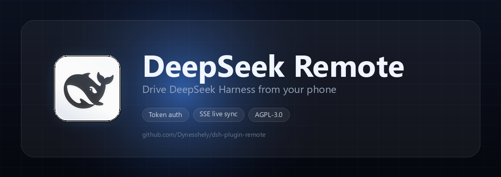

<div align="center">
  
</div>

# DeepSeek Remote

DeepSeek Remote is a plugin for [DeepSeek Harness][dsh] that serves the desktop app's conversation as a
web page, so you can read answers, send prompts and manage sessions from a phone, a tablet or another
machine on the same network. It talks to the Host it runs inside — no separate daemon, no cloud relay —
and every request is gated by a token you own.

<p align="center">
  <a href="LICENSE"></a>
  
  
  
  
</p>

<p align="center">
  
  
  
  
</p>

## Features

- **The conversation, live.** Transcript, streaming answers, reasoning chains, tool calls and grouped tool
  runs arrive over Server-Sent Events.
- **Prompts from anywhere.** Markdown composer with live preview (CodeMirror 6) and image attachments.
- **Session management.** Create, rename, pin, fork and archive — changes are mirrored both ways, so a pin
  made on the phone shows up on the desktop.
- **Model control.** A picker with real brand marks, plus a catalogue browser showing context windows and
  available reasoning effort.
- **Balance and usage.** One card fed either by an aggregated gateway endpoint or by per-vendor API keys.
- **Restart or quit DSH** from the page, through an out-of-process helper that outlives the app.
- **Pictures that actually load.** A same-origin image proxy resolves both real URLs and workspace paths,
  with click-to-zoom.
- **Built for a phone.** Glass UI, prompt rail, lazy-rendered transcript, and scroll compensation so
  content that renders above the viewport never throws the reader off.
- **Token-gated, single process.** One Host half with no build step, one static SPA, one shared secret.

## Requirements

- **DeepSeek Harness** desktop app — the plugin runs inside it and drives its Remotes.
- **Node.js 18+** — only to rebuild the SPA or run the test suites.
- A phone, tablet or another computer on the same network, or a tunnel such as WireGuard or Tailscale.

## Install

1. Clone this repository and add it to your DSH profile as a bundle. `cordis.patch.yml` carries the ready
   profile line (`bind`, `port`, `token`).
2. Start DSH. The Host log prints a URL you can open directly:

   ```
   http://127.0.0.1:19400/?k=<token>
   ```

3. Open it on the device. **`?k=` is used once only** — the page exchanges the token for an
   `HttpOnly; SameSite=Strict` cookie and cleans the address bar.
4. The token is generated on first start and stored in `~/.dsh/remote-control/auth.json` with `0600`
   permissions. Set `token:` in the config to pin your own instead.

## Configuration

```yaml
- id: remote-control
  name: '@local/dsh-remote-control'
  config:
    bind: '0.0.0.0'     # 127.0.0.1 keeps it local; 0.0.0.0 exposes it to the network
    port: 19400
    token: ''           # empty = generated once, then persisted
```

### Exposing it

- **Tunnel (recommended).** Keep `bind: 127.0.0.1` and reach it through WireGuard, Tailscale or an SSH
  forward. Nothing is exposed, and the page still gets a secure context.
- **Direct LAN.** Set `bind: 0.0.0.0` and open `http://<lan-ip>:19400/?k=<token>`. Over plain HTTP on a
  non-loopback address the browser treats the page as an insecure context: installing it as an app,
  notifications and some clipboard APIs are unavailable. Terminate TLS in a reverse proxy if you need them.

### Windows firewall

Direct LAN access also needs an inbound rule. The repository ships a script (**needs administrator
rights**; it will raise a UAC prompt):

```powershell
# allow inbound TCP 19400 for the Domain/Private profiles, local subnet only
pwsh -File plugins\remote-control\tools\firewall-remote-control.ps1

# remove the rule again
pwsh -File plugins\remote-control\tools\firewall-remote-control.ps1 -Remove
```

The rule is named `DSH Remote Control (TCP <port>)`. It only opens the firewall — the listener still
follows `bind`, so the rule exposes nothing while `bind` is `127.0.0.1`.

## How to Dev

### Build the UI

The Host serves `ui/dist`, so the SPA has to be built before it is used:

```bash
pnpm --dir plugins/remote-control/ui install
pnpm --dir plugins/remote-control/ui run build   # emits ui/dist
```

### 运行形态（生产 / 开发）

**生产：宿主是纯后端。** `index.js` 只做两件事——托管 `ui/dist` 的静态资源、提供 `/api/*`（外加
`/healthz`）。它不内置任何页面：`ui/dist` 缺失（或没有 `index.html`）时只回一个内联样式的 503
说明页。`/api/*` 与 `/healthz` 永不回退成 HTML；带扩展名的路径（`/assets/x.js`）缺失时回 404 ——
否则浏览器会把 HTML 当 JS 解析，控制台里冒出一条与真问题无关的语法错误；只有无扩展名路径
（`/`、`/files` …）回退到 `index.html`，history 路由才能直接打开。

**开发：Vite 管前端，宿主只做反代。** 先用 `pnpm --dir plugins/remote-control/ui run dev` 起 Vite
dev server（默认 `http://127.0.0.1:5173`），再把它的地址告诉宿主：

```bash
# Windows PowerShell（在启动 DSH 之前设置）
$env:RC_DEV_ORIGIN = 'http://127.0.0.1:5173'

# macOS / Linux
export RC_DEV_ORIGIN=http://127.0.0.1:5173
```

设置后，宿主对所有非 `/api/*`、非 `/healthz` 的 GET 请求做流式反向代理（method 与 headers 原样
转发，dev server 的响应原样回传）：HMR 与模块转换由 Vite 提供，数据和鉴权仍由宿主提供，`/api/*`
永远不转发。该变量在插件加载时读取，**改完要重启 DSH**；不设置时行为与生产完全一致，dev server
没起或连不上时宿主回 502 而不是崩溃。反代出来的静态路径与普通静态资源一样不校验 token，它只是
开发开关，不要在生产上设置。用手机访问时 HMR 的 WebSocket 由浏览器直连 dev server，所以 Vite
也要监听一个设备能访问到的地址（`server.host`）。

### Run the tests

Every suite is a standalone script; none of them needs DSH to be running. The integration suite boots the
plugin in-process and drives it over real HTTP and SSE.

```bash
node plugins/remote-control/tools/test-remote-control.mjs      # Host: auth, routes, SSE, models, permissions, attachments, paging
node plugins/remote-control/tools/test-remote-ui-store.mjs     # transcript folding: tool groups, context notes, images
node plugins/remote-control/tools/test-remote-ui-questions.mjs # questions: argument/answer parsing, recommended flags
node plugins/remote-control/tools/test-remote-ui-rail.mjs      # prompt rail: ticks, active detection, geometry
node plugins/remote-control/tools/test-remote-ui-layout.mjs    # mobile detection: viewport vs overflow
node plugins/remote-control/tools/test-remote-ui-highlight.mjs # highlighting: language set, injection, Markdown pipeline
node plugins/remote-control/tools/test-remote-ui-loading.mjs   # loading phases: slow notice, failure, retry and cancel

# read-only probe against a running instance
node plugins/remote-control/tools/smoke-remote-control.mjs http://127.0.0.1:19400 <sessionId>
```

### Hot reload

- **Browser half.** The SPA reloads like any Vite app; layout, styles and components need no restart.
- **`host/hot.js` and its siblings** are imported with an mtime-derived query, so an edit takes effect on
  the next HTTP request — `POST /api/__reload` forces it.
- **`index.js`** is part of the Loader's module generation: changes there need a **DSH restart**. Toggling
  the bundle only re-applies the cached module.

## Project Structure

```
plugins/remote-control/
├── index.js               Host half: HTTP server, auth, routes, SSE, ui/dist hosting (+ dev proxy)
├── host/
│   ├── hot.js             Hot-reloadable routes: session management, DSH control, presets
│   ├── usage.js           Balance and usage aggregation, gateway first
│   └── model-meta.js      Context windows, joined from the gateway's /v1/models
├── ui/                    Vue 3 + Vite SPA
│   ├── src/components/    Transcript, composer, sidebar, usage card, model browser …
│   ├── src/lib/           Store, Markdown pipeline, lazy rendering, API client
│   └── public/            App icons
├── locale/                UI strings (en, zh)
├── tools/                 Test suites, smoke probe, firewall and DSH control scripts
├── docs/poster.png        README hero image
├── page.html              历史遗留文件：宿主已不再读取（只托管 ui/dist）
└── package.json, cordis.patch.yml   Bundle manifest and profile line
```

## HTTP API

Every route except `/` and `/healthz` requires the session cookie or `Authorization: Bearer <token>`.

| Route | Purpose |
|---|---|
| `GET /healthz` | Unauthenticated liveness check |
| `POST /api/login`, `/api/logout` | Exchange the token for a cookie, and back |
| `GET /api/state` | Sessions, workspaces, pending interactions, bind info |
| `GET /api/stream?sessionId=` | SSE: `hello`, `pending`, `sessions`, `frame`, `stream-error` |
| `GET /api/models`, `POST /api/select-model` | Model catalogue and switching |
| `GET /api/older?sessionId=&beforeSeq=` | One page of older history (`{ records, hasMore }`) |
| `GET /api/attachment?sessionId=&attachmentId=` | Image bytes from a session log |
| `GET /api/image?url=|path=` | Same-origin image proxy for the transcript |
| `GET /api/usage`, `POST /api/usage/config` | Balance and usage, plus its configuration |
| `GET /api/model-meta` | Context windows per model id |
| `GET /api/dsh/info`, `POST /api/dsh/restart`, `/api/dsh/exit` | Describe, restart or quit DSH |
| `POST /api/send`, `/api/cancel`, `/api/answer` | Send a prompt, stop a turn, answer a question |
| `GET /api/permissions`, `POST /api/permission` | Permission presets and switching |

## Security

- A 32-byte token gates every `/api/*` route; comparisons are constant-time, and both the session cookie
  and an `Authorization: Bearer` header are accepted.
- Failed logins are rate-limited per peer (6 per minute); request bodies are capped; static-path traversal
  is rejected; the page runs under `default-src 'none'` with `frame-ancestors 'none'`.
- Model output is sanitised with DOMPurify before it reaches the DOM — the page holds agent-control
  credentials, so no model text is trusted.
- **A token is equivalent to code execution on the machine that runs the agent.** Do not share it, and put
  TLS or a tunnel in front of any non-loopback binding.

## Limits, by design

- **Tool approvals cannot be confirmed remotely.** Approval is a single-slot waterfall owned by the
  desktop answerer; hijacking it would leave the desktop panel waiting for an answer that never arrives.
  The page shows what is waiting and asks you to confirm on the desktop.
- Switching permission presets needs a live session — a cold one is resumed first.
- This is not a mirror of the desktop UI: no file tree, terminal, trace view or queue editing.

## Star History

<a href="https://star-history.com/#Dynesshely/dsh-plugin-remote&Date">
  <picture>
    <source media="(prefers-color-scheme: dark)" srcset="https://api.star-history.com/svg?repos=Dynesshely/dsh-plugin-remote&type=Date&theme=dark" />
    <source media="(prefers-color-scheme: light)" srcset="https://api.star-history.com/svg?repos=Dynesshely/dsh-plugin-remote&type=Date" />
    
  </picture>
</a>

## License

Released under the [GNU Affero General Public License v3.0](LICENSE). In short: use it, change it, share it —
but if you run a modified version as a network service, you have to offer its source to the people using
it.

[dsh]: https://github.com/Dynesshely
